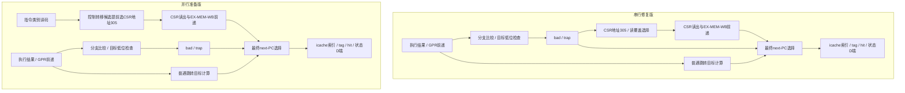

# CRP F0003 — 指令目标对齐与双端异常边界

> 当前结果：F0003双端修复及mtvec并行准备补充已完成；用户2026-10-19“提交”确认已报告结果和限制并授权本批提交。最新验收见[补充交付](#parallel-mtvec-result-20261019)，实际Git回执见[确认/提交补充](#approval-submit-20261019)及本地记录。

2026-10-19 Start。用户“提交后继续”授权F0001确认提交252eaea后执行既有唯一入口一个单元，承接上一轮双端必要修复要求。

## 既有计划与停点

沿TASK_QUEUE已落档边界：复现NEMU JAL/JALR/taken branch错位原例，核NPC对应译码/目标计算/提交与CSR能力及LINUX_PLAN §4。两端既有契约明确则直接最小修复并定向/真实构建/消费者回归；若双端闭合涉及原M3新异常能力，先形成具体最小方案与取舍，停下请用户裁决，不自动扩大到完整M3。无安装、Make变更或自动提交。

交付本报告/局部ignore、逐端原始证据与必要索引/状态；若有获准生产修复另列实际改动，不预写完成。验收依据为no-C/IALIGN32、错位cause0/原PC/tval目标且rd不提交；not-taken无错位异常，合法低域行为保持。双端独立核对，不能只靠difftest相等。

## 本轮边界核验结果（修复未开始）

**F0003仍未修复；已完成必要分析，待用户裁决双端新增能力范围。** F0001已确认提交252eaea，当前无生产修改；M2/M3均未推进。

| 层次 | 本次实测 / 静态证据 |
|---|---|
| NEMU生产执行链 | 原P2 repro.c链接本次成套CPU/ISA/MMU/内存，GCC-O2分别执行JAL +2、JALR目标PC+3（清bit0后PC+2）、BEQ taken +2。三例pc均80000002，mepc/mtval仍0；JAL/JALR的x5从55变80000004。故障指令本应转mtvec=80000100、cause0、mepc=80000000、mtval=80000002并保留x5。cause原值0本身不能证明异常发生，PC/epc/tval/rd共同确认没有正确trap。见local/nemu-results.json及三原始日志 |
| NPC原RTL模块 | 从当前ysyx_22040750.v原样提取decoder、npc目标计算、mux和csr四模块，Icarus执行受控输入：JAL +2/JALR +3均target=80000002、reg_wen=1、trap=0；BEQ taken同错位目标/trap=0。not-taken BEQ和JAL +4返回80000004，作为正常控制。这里只证明译码/目标生成控制缺口，不称已动态观察完整流水GPR写回或运行了真实SoC guest。见local/rtl-source.json、rtl-results.json/rtl.log |
| NPC CSR缺口 | 当前csr模块没有mtval(0x343)寄存器或异常tval传递端口；对0x343写80000002后读回0，落默认分支。decoder的trap仅ECALL/EBREAK/timer，跳转错位没有trap信号；O_reg_wen未对错位抑制。生产源码可定位约1485–1580、2451–2499、3867–3934行，精确源SHA见local身份 |
| 既有计划边界 | [LINUX_PLAN §4](../../../../docs/LINUX_PLAN.md#4-m3-npc-特权架构msu--委托--精确异常停点)将NPC CSR扩容、特权/精确异常与OPT-17异常补全归M3；当前NPC明确为M态实现，M/S/U委托尚未实施。NEMU已有D21/riscv_raise_exception可复用，NPC缺少本异常的端到端状态承载，不能仅改一个目标比较便宣称双端修好 |

依据（2026-10-19读取）：[官方I规范](https://docs.riscv.org/reference/isa/_attachments/riscv-unprivileged.pdf)Control Transfer/IALIGN（当前返回20260120），无C时跳转或taken branch错位异常在原指令报告，not-taken不触发；[ICS-PA2.2](https://ysyx.oscc.cc/docs/ics-pa/2.2.html)译码/动态PC背景。仅补充项目既有no-C范围，不新增C扩展，也不把普通数据对齐EEI与本项混同。

## 可裁决的最小方案

**建议A：明确允许本CRP提前实现双端的最小M态指令对齐异常闭环。** 这是一项窄范围M3能力提前落地，不能记为M3整体启动或完成。

1. NEMU：inst.c中先计算JAL/JALR最终目标（JALR先清bit0），在rd/dnpc成功提交前检查target&3；错位经既有riscv_raise_exception(0,原PC,target)进入现有M/S trap，taken branch同样检查，not-taken保持顺序执行。保留RV32旧分支、现Make/REF ABI和其他异常契约。
2. NPC：在现有32位PC/目标地址域检测JAL/JALR/taken branch的bit1；以故障指令PC、cause0和目标tval作为同一条异常载荷传入提交端，抑制该指令的GPR/访存副作用及错误路径后继，选择mtvec，确保只trap一次。增加mtval存储/读写与tval沿ID_EX/EX_MEM/MEM_WB的承载，复用现M态trap/mret状态栈；核对timer同时到达、旧指令在途与背压时的精确提交/CSR转发。预期涉及decoder/next-PC、主核接线、三流水寄存器、csr及必要验证断言；最终按实现影响确认，不预写未执行的信号方案为成品。
3. 边界：只补本cause0及所需M态精确提交，不新增NPC S/U/委托/MMU、通用异常矩阵或普通数据对齐陷入；不改变NPC现有地址宽度、Make接口/用户流程。NEMU现有S/U/委托能力按原契约验证；NPC本次只验证M态，不声称两端已有相同特权能力。
4. 验收：±2/合法对齐目标、JALR bit0/bit1组合、六branch taken/not-taken、rd=rs1/x0、原PC/rd/cause/tval；NPC定向流水/背压/在途提交与timer碰撞、真实SoC自检guest、错误期望/判据负例；新同版native/REF/NPC模型、CPU全集和受影响RT/nanos回归。若RTL路径影响时序，遵循既有timing/STA流程披露结果；不能用旧模型或模块级仿真代替修改后全SoC验证。完成后统一留档停等确认/commit。

**选项B：本次不提前新增NPC异常能力，将F0003双端修复留到M3并明确延期，后续转向独立CRP修复。** 两端缺陷与反例继续保留，不把F0003标Completed或从77项未修完中扣除。若用户要只修NEMU、NPC延期，这是对上一轮双端必要修复要求的另一个明确取舍，需要显式说明，agent不会自行选择。

## 停点来源与状态

[TASK_QUEUE当前入口](../../../../../../.agent/TASK_QUEUE.md#crp-next)已要求：若双端修复引入原M3新能力，停止相关实施并提出最少裁决。本轮已据实际RTL和CSR证据触发此门槛；[WORKFLOW_POLICY §3](../../../../docs/WORKFLOW_POLICY.md#3-人工确认--软件安装-停点触发即停)规定“超出已批准范围、改变功能/失败语义等真实契约取舍……停下来问”。上一轮对ADDIW等的双端必要修复指令已承接，但不能据此默默提前整个NPC异常能力；这里请求明确批准上述窄范围A，或选择延期B。

本轮只做原例/原模块分析：3次NEMU CPU执行观察、5个NPC控制观察与1个CSR限制观察，原始命令/退出码、成套源码和模块SHA均local保存；运行exit0代表反例观察成功，绝不代表产品行为正确。没有执行修复后的native/REF/NPC构建、真实SoC guest、CPU/RT/nanos回归，因为生产修复未开始；不复用F0001验收冒充本轮结果。无需安装，无运行中动作、无新commit/push，root HEAD252eaea。

测试脚本/TB、源码副本、日志/JSON/工具产物仅local保留；报告/ignore及必要索引为本批文档改动。普通commit不备份ignored/.agent资产。累计仍 **42项Completed / 77项未修完**，F0003未修；下一动作只等待上述范围裁决，阻塞仅作用于F0003，不扩为其他独立修复前置。未创建新的业务Milestone/Phase Completion。

<a id="approval-A-20261019"></a>
## 2026-10-19 方案A批准与实施

用户明确“同意建议A，开始修复”，并要求NPC与ecall等主动陷入共享控制时序和链路。范围裁决已解除；沿当前同一F0003单元实施，不要求先提交分析文档。仅提前补本cause0及所需mtval/精确提交，其他M3能力仍原计划。实现优先复用现csr_intr、mtvec重定向、三流水载荷与WB有效提交，不另起独立异常FSM；ecall/ebreak/timer的tval置0。验证按原A计划及新增共享链路要求执行，证据位于local/implementation，原57文件分析manifest不覆盖。未授权新commit/push/安装。

<a id="implementation-20261019"></a>
## 方案A实施结果与共享链路

**F0003双端功能修复完成，时序回退尚未获用户接受。** NEMU的JAL/JALR及实际taken branch先检查最终目标，再提交链接寄存器/PC；错位调用既有`riscv_raise_exception(0, pc, target)`。JALR先清bit0，not-taken不检查目标；RV32旧分支保持。例：PC=80000000的JAL +2现在进入mtvec、mepc=80000000、mcause=0、mtval=80000002，原rd保持，不再跳到80000002并写rd。

NPC在ID使用已前递的rs1、当前PC和立即数检测错位，将其并入现有`csr_intr`/`csr_jr`。异常仍走 **ID选择mtvec并清除错误路径 → ID_EX → EX_MEM → MEM_WB → 有效WB提交CSR**，沿用ecall的stall/bubble、handler等待和mret链路；没有新FSM或额外异常控制阶段。故障跳转关闭reg_wen，branch原本无GPR/访存写。32位tval与cause使用相同流水使能，新增64位MTVAL(343)支持完整软件读写，陷入时写零扩展的当前32位地址域目标；ecall/ebreak/timer写0，mret保留。trap的CSR读地址统一305，以复用在途mtvec写的前递。

时间点沿用两端各自既有实现：NPC的timer在ID把原指令替换成NOP，受控timer碰撞和ecall同优先级；NEMU在执行后轮询中断，同步异常先于该次轮询。没有声称两端中断采样逐周期相同，也没有将本次扩为完整异常优先级矩阵。D23记录此次窄范围批准；M2/M3整体均未启动。

可维护交付为`nemu/src/isa/riscv32/inst.c`、`npc/vsrc/ysyx_22040750.v`、现有两份CSR断言和`npc/verif/tests/inst_misaligned.S`。新增用例由既有通配入口自动发现，没有改Make选项/目标。断言新增mtval与有效陷入载荷一致性；原MEPC监视器只跟踪软件写、未跟踪trap自动写而误报，本次补齐该提交事件，并用故意错误前递确认它仍会拒绝错误。

## 本次验证与证据

所有修复后测试使用本组新构建native/REF/NPC及匹配源码，保留原REF ABI；根目录默认模型、配置和已验收RT镜像未替换。以下为本次结果，不复用前组动态测试冒充本组验收：

| 验证层 | 实际结果 / 覆盖 | 本地证据（相对local/implementation） |
|---|---|---|
| NEMU独立期望 | GCC-O2、UBSan各76/76；±2/±4、JALR低位0–7/高64位/负目标、rd=rs1/x0、六branch taken/not-taken，32GPR/PC/原PC/cause/tval/特权、现有S/U委托及同步异常/轮询timer | directed.py、repro.c、directed-results.json、directed/ |
| 当前NPC模块 | 71个适用的译码向量全通过；timer替换与ecall共享路径、ID_EX载荷stall三拍保持、无效WB不写CSR、64位MTVAL读写/后续ecall清零 | rtl.py、rtl-tb.sv、rtl-results.json、rtl/ |
| 真实双端guest | 12次cause0+一次ecall，在新native、REF、实际SoC均GOOD；检查恰13次、六种分支、错误路径、rd保持、原PC/mtval/MIE、mret、先前store/load-use | guest.py、align.S、guest-results.json、align-*.log |
| 真实NPC流水补充 | 原rs1错位而load/EX前递后目标对齐不误trap，旧MDU结果先提交；紧邻csrw mtvec后的错位trap和ecall分别到新handler。两guest各在新native及SoC+REF GOOD | hazards-results.json、vector-forward-results.json及原日志 |
| 保留回归 / 负例 | 新inst_misaligned.S真实SoC GOOD；把总trap期望改错后native BAD/exit1、NPC主终态BAD ret1（进程exit0），均正确拒绝，未误算REF附加终态 | extra-guest-results.json、maintained-soc.log、bad-align-*.log |
| 微测试与断言 | 15/15微测试逐项检查原始RESULT；既有make assert在CACHE_CHECK_OFF模式15/15；MEPC正确trap读通过，注入错前递触发预期$error | micro-results.json、assert-result.json、monitor-results.json及日志 |
| 新模型/CPU全集 | native/REF真实构建、native smoke和原ABI通过；新RTL全SoC构建成功；NPC+新REF及native各36 PASS+wrong 1 XFAIL，make0，74份主终态/退出码独立核验 | builds.json、soc-build-result.json、cpu-results.json、两平台cpu-logs/ |
| RT实际SoC | 同一已验收镜像配本组新NPC/REF，171.45秒到msh，difftest ON；观察后自有组SIGTERM，exit -15，非guest正常退出 | rt.py、rt-result.json、rt.log |
| nanos实际native | 51.74秒，F2终端命令/F3幻灯0→1→0/F1回PAL及Enter，8帧目视核对、hello 1316→5722递增；观察后自有组SIGTERM/-15 | nanos/result.json、8份BMP、contact.png、nanos日志 |

`verify.py`核验28项功能/身份/退出码/判据条件全部通过，另6种host判据污染均拒绝；原分析57项和前组326项manifest无漂移，根默认模型/配置保护、HEAD252eaea、空index及diff空白检查保持。`identity.json`保存实际源码/新模型/测试SHA，`repair.patch`保留生产与断言差异；最终11项收尾检查通过，实施manifest含385个文件条目；它是证据文件数，不是测试数量。原57项manifest只覆盖实施前分析，实施证据另见`local/implementation/manifest.json`。

尝试记录保留：初次SoC构建的重复I_pc声明已修正；初次false-BNE夹具仍用了不等操作数已纠正；初次make assert暴露MEPC监视器漏记trap写（旧mret测试也失败），补齐后15项全通过，并额外注入错误确认检查有效。以上失败不冒充通过结果；最终模型/源身份核验一致。

## 时序结果与需用户确认的取舍

两版均用现有`gen_synth_rtl.py`剥离DPI/黑盒SRAM，以Nangate45 typ、clock/500MHz约束、相同已有工具做综合和iEDA STA。系统默认Yosys0.33不支持当前脚本clockgate；改用**已安装**oss-cad-suite的Yosys0.68，仅本进程PATH生效，无安装或全局环境变更。为控制原`share -aggressive`分析耗时，在本地复制的脚本上给两版均加`-fast`；全局yosys-sta脚本未改。它是同配方前后对照，不能直接替代历史旧工具/配方的频率基线。

| 指标 | 修复前 | 修复后 |
|---|---:|---:|
| 综合面积（不含8个黑盒SRAM，µm²） | 119631.904 | 120951.530（+1.10%） |
| 报告最差路径延迟（ns） | 2.467 | 2.777 |
| 500MHz最差setup slack（ns） | -0.506 | -0.809 |
| 报告估算频率（MHz） | 399.074 | 355.983（-10.80%） |

两版综合check均0问题，syn/sta退出0；**这不代表500MHz时序收敛**，两版均不满足该约束。两版最差终点均为icache current_state_7，起点/组合映射有变化；不能只据该路径断言某一个新增门就是全部回退原因。这里没有布局布线/真实SRAM时序或板级频率结论。

详细命令、工具版本、净表SHA与原报告见`timing-current-fast-results.json`、`timing-tool-version.log`、`timing-summary.json`及`sta-current-fast-{before,after}/ysyx_22040750-500MHz/`。原配方使用已安装0.68：修复前syn/STA于569.73秒完成、面积/slack/频率与fast版一致；修复后在share阶段达到600秒时限，自有进程组SIGTERM/-15，未生成STA结果，不能计原配方双端全部通过。旧0.33原配方超时及fast版不支持clockgate的尝试也独立保留，不写成STA通过。**按WORKFLOW_POLICY §3性能取舍停点，当前等待用户决定接受这一已披露回退，或在同一F0003单元继续优化后重验；没有擅自接受性能降级或开始另一组。**

## 范围、持久化与停止状态

NPC仅当前M态/32位PC域的cause0；不新增S/U/委托、MMU、普通数据对齐、非法指令等完整异常或更宽地址。NEMU仅RV64路径改变，RV32/RVE/其他ISA/PMEM64完整配置/Linux/形式验证/全部cache断言/长时与实际声音均未本次验收；NPC真实timer精确撞拍长时压力未测，碰撞优先验证是受控ID向量。CPU沿用已记录符号/-j1测试兼容配置。RT/Navy生成器与应用源不变，复用已验收镜像/ramdisk，未重做update，也没有声称修复既有PAL性能问题。

功能计数为**43项已修 / 76项未修完（总119）**，其中本项功能Completed但用户结果/时序接受/commit Pending；此前42项已确认提交。F0040Partial、五CQ、F0043、F0026和两缺源等原限制保持。本组报告、process/repair-status索引及本地状态/唯一下一入口已同步；一次性夹具、完整源码/构建、日志/截图/镜像仅local保留，不随普通commit备份。当前Working tree contains uncommitted CRP changes，HEAD252eaea、index空，无新commit/push/安装。停在本组性能取舍/确认门槛，不自动进入后续修复或业务Milestone。

<a id="parallel-mtvec-20261019"></a>
## mtvec并行准备补充实施计划（2026-10-19）

用户在路径解释后明确“同意你的建议，实施”，授权在同一F0003内优化：mtvec读取与前递预先并行准备，错位判定只控制最终跳转目标选择。原F0003已Completion，下一组未Start，本问题属于原范围；本轮按Reopen处理，保留原功能/STA/385文件清单，不改写已完成快照。新证据local/parallel-mtvec。

实现采用现有CSR读口：根据指令类别（JAL/JALR/branch/ecall/ebreak/timer）提前选305，而非等待target_misaligned或branch比较结果；CSR读口不再由晚到的csr_intr二次覆盖。所有控制转移候选提前读/前递mtvec，只有实际trap使用该值，非trap候选保持普通跳转行为，CSR写使能保持原值。MRET提前选MEPC。保留现有CSR模块接口和陷入ID重定向/三流水/有效WB提交，不添加阶段/FSM或新功能范围，NEMU不再改动。

验收与停点：当前71译码向量、额外检查mtvec预读不依赖操作数/是否taken，EX/MEM/WB的mtvec前递优先级；新RTL全SoC配既有同版REF，原13trap/合法目标/错误路径/load/EX旧值/旧MDU/相邻mtvec写guest及错误期望负例，15微测试/15断言、NPC CPU全集与RT到msh。NEMU及nanos源/模型未变、纯NPC读路径不影响其执行，复用原验收，不无故重跑。用相同已完成的fast-share/工具/PDK/约束比较原实现、串行修复和本优化；披露时序与未测，必要时按原性能取舍门槛停下。完成补充留档、索引/状态和Supplemental Completion后停止，不自动提交或进入下一组；无安装/全局脚本/Make接口变更。

<a id="parallel-mtvec-result-20261019"></a>
## mtvec并行准备补充交付（2026-10-19）

**优化完成，保留F0003原功能和共享ecall提交链路；同配方估算频率回退已消除。** 生产补充仅RTL两处：decoder按指令类别提前为JAL/JALR/所有branch/ecall/ebreak/timer选择CSR地址305；core的CSR读侧`I_csr_intr_rd`固定0，避免晚到错位/分支结果再次覆盖读选择。现有CSR读口和EX>MEM>WB前递因此提前准备mtvec，只有`csr_jr`在最终next-PC选择时实际使用；对齐跳转和not-taken branch虽预读mtvec，但不写CSR、不进入陷入。MRET仍提前选择341，CSR模块原有接口保留。没有加独立读口、流水级、FSM或改变trap载荷/WB有效提交；NEMU和两份断言、维护的汇编用例均无补充修改。

这是对上轮性能取舍的获准优化，非接受原10.8%回退。上轮385项证据/原结果与Completion快照保持，本次local/parallel-mtvec单独保存新模型、命令、结果、补充patch/身份及manifest；不覆盖local/implementation。

| 本次补充验证 | 实际结果与证据（相对local/parallel-mtvec） |
|---|---|
| 当前RTL模块 | 原71译码向量/受控timer/载荷背压/CSR测试通过，额外要求所有控制转移候选地址均为305；14项预读/EX-MEM-WB优先级/地址不匹配回退/ECALL/普通CSR/MRET检查通过。旧串行decoder违反新的预读结构约束、注入错误EX值均被拒绝；旧版拒绝是结构要求反例，不冒称旧功能陷入错误。见rtl-results/pre-read-result/pre-read-negative-results及日志 |
| 新实际SoC | 新RTL构建17.43秒完成，配原同版REF；原13trap guest、合法/错位/错误路径、stale target/load/EX及旧MDU提交、紧邻mtvec写后的fault/ecall三个guest均GOOD/difftest ON。维护用例实际SoC GOOD；错误期望trap总数实际NPC主终态BAD ret1/进程exit0被正确拒绝。见guest/hazards/vector-forward/extra-guest-results与原日志。本补充仅执行变更的NPC，NEMU结果沿用前次 |
| 微测试 / 断言 | 15/15普通微测试逐项原始RESULT检查；既有CACHE_CHECK_OFF模式make assert 15/15，无%Error。见micro-results.json、assert-result.json及日志；未重跑assert-cache/形式化 |
| NPC CPU全集 | 新SoC+同版REF，36 PASS+wrong 1 XFAIL，make0，68.18秒；37份实际主终态/ret/退出码单独核验，不将REF附加终态当主终态。见cpu-results.json和npc-cpu-logs |
| RT实际SoC | 同一已验收镜像配新NPC/原同版REF，169.64秒到msh/difftest ON；自有进程组SIGTERM/-15，非guest正常退出。见rt-result.json/rt.log |
| 一致性收尾 | 24项补充验证全通过：新SoC/微测试/STA与生产RTL相同、新二进制身份、原385条清单和默认模型/配置未变、NEMU源/模型/原ABI与两断言/维护用例未改、HEAD252eaea/index空。见validation.json/identity.json/supplement.patch |

NEMU、native模型、REF与nanos执行路径未改，本次复用前次NEMU定向/CPU/ABI与nanos八帧/hello验收；不声称本轮重跑这些未受影响消费者。RT/Navy源不变复用已验收镜像，不重update；CPU原测试兼容配置和其余未测边界沿原报告。

### 三版本同配方时序

复用上次**已完成**的原版/串行修复对照，新优化重新执行同一isolated fast-share脚本、已安装Yosys0.68/iEDA、Nangate45 typ、500MHz/ideal clock、8个黑盒SRAM。flow输入SHA与工具版本逐项核对相同；未安装或更改全局脚本/环境。

| 指标 | 修复前原版 | 串行F0003修复 | 本次并行准备 |
|---|---:|---:|---:|
| 综合面积（不含SRAM，µm²） | 119631.904 | 120951.530 | 119948.444 |
| 报告最差路径延迟（ns） | 2.467 | 2.777 | 2.343 |
| 500MHz最差setup slack（ns） | -0.506 | -0.809 | -0.380 |
| 报告估算频率（MHz） | 399.074 | 355.983 | **420.232** |

本次相对串行版估算频率+18.05%、面积-0.83%；相对原版频率+5.30%、面积+0.265%。综合check 0问题，syn/STA退出0，186.32秒完成。最差终点转为icache hit_flag_1。这里能证明本次同配方对照中的回退已消除，不能据此将全部收益精确归给某一个门；综合整体映射也参与变化。**仍不满足500MHz约束，且不是布局布线/真实SRAM/板级频率结论。** 原慢share流程后版600秒超时的历史事实保留，本次没有重跑该未完成配方或宣称它通过。详见timing-result/timing-summary/timing-flow-inputs、工具版本和sta-optimized报告/净表。

本轮执行Supplemental / Reopened Completion，累计43功能已修/76未修完不重复计数；原性能回退停点经用户批准的优化及本次证据解除，当前只等待新结果确认/commit，不从用户实施授权推定已复核新结果。HEAD252eaea，Working tree contains uncommitted CRP changes，index空，无运行中动作/新commit/push/安装。唯一未来入口沿TASK_QUEUE维护，F0009仍Planned未Start，M2/M3不推进。ignored测试/构建/日志与.agent不随普通commit备份。

<a id="approval-submit-20261019"></a>
## 2026-10-19 确认/提交补充

用户“提交”确认F0003原双端功能修复及mtvec并行准备补充的已报告范围/限制，授权本批提交；不是完整M3/500MHz/未测能力验收，不授权push或下一单元。57项分析、385项原实施、193项补充manifest均无漂移，28/11/24/8项既有核验保持；最终生产源、维护测试/断言、新NPC与未变NEMU/REF、默认保护身份一致。复用动态验收，不重跑guest。

本批提交范围为11文件：inst.c、NPC核心、两份CSR断言、inst_misaligned.S、npc/verif两级README、本报告/局部ignore、process索引和repair-status；一次性夹具/完整构建/日志/镜像/截图与.agent/docs忽略资料不强制入库。实际暂存/提交集合、commit SHA、终检与干净状态见local/parallel-mtvec/submit-receipt.json及.agent确认/提交回执；本条随所述提交交付，不自引用预猜commit SHA。当前确认已获得，实际提交以Git回执为准。提交后停止，F0009仍未Start，M2/M3不推进，无push；ignored资产不因commit被备份。

<a id="timing-technique-20261019"></a>
## 时序优化技巧：提前准备候选数据，晚到条件只控制最终选择

本节总结已提交c920dbe的实现与前后同配方STA证据，交付依赖图、判断逻辑对照、适用条件和验证方法，并登记到knowledge经验地图。仅补说明/索引，复用本报告验收，不改RTL/环境、不新增Phase或启动F0009；用户后续“完成修改后直接提交”授权本次文档补充提交。

### 判断逻辑为何形成串行依赖

错位判定不仅是指令编码译码，还依赖前递操作数。当前32位目标域可概括为：

```text
sum = (JALR ? forwarded_rs1 : PC) + imm
taken = JAL | JALR | branch_taken
bad = taken & (sum[1] | (sum[0] & ~JALR))
trap = ECALL | EBREAK | timer | bad
```

其中branch_taken来自rs1/rs2比较；JALR先清bit0，故其bit0不触发错位，bit1仍须检查。not-taken即使编码目标错位也不trap。`bad`参与故障rd写回抑制和tval载荷生成的逻辑保持原样。

串行修复版以`bad`决定是否把CSR地址改成305，并让`trap`覆盖CSR模块的读选择：

```verilog
// 串行修复版
O_csr_addr = (timer | ECALL | EBREAK | target_misaligned) ? 12'h305 : ...;
.I_csr_intr_rd(csr_intr)
```

CSR前递还须用这个地址与EX/MEM/WB的在途写地址比较。因此晚到的操作数/branch比较结果不仅控制“跳不跳mtvec”，还推迟“读哪个CSR、前递哪个CSR”的准备。ECALL编码本身即可判定，而错位判定要等待操作数；共享提交链路并不自动保证组合延迟相同。

### 前后串并行结构

下面为逻辑依赖示意，包含原有正常跳转和新陷入路径；并非对每个映射门的逐一还原。



现在按指令类别识别“可能使用mtvec”的集合，不必等它最终是否发生异常：

```verilog
// 当前版：分支是否taken、目标是否错位不再决定CSR预读地址
O_csr_addr = (timer | ECALL | EBREAK | JAL | JALR | typeB) ? 12'h305 : ...;
.I_csr_intr_rd(1'b0)
```

这两处须配套：第一处让CSR读地址与前递匹配提前稳定；第二处在core关闭晚到trap对CSR读口的再次覆盖。只改地址、仍让trap控制CSR读mux，会留下晚到依赖。MRET仍预选341，CSR模块原接口保留。普通CSR指令继续按编码读写。

复用的是现有CSR读口和前递器。即使JAL/JALR目标对齐、branch不跳或跳到合法目标，mtvec仍可提前准备；最终未选它时不会增加CSR写入或trap。原EX>MEM>WB前递优先级保留，避免刚写mtvec后仍跳旧向量。tval/cause/epc仍沿同一陷入流水在有效WB提交，没有通过增加周期或推迟异常来换频率。

忽略公共部分、将晚到判断与候选数据准备抽象为两项，串并行差别可写成：

```text
串行：T判断 + T_CSR准备 + T最终选择 + T后级
并行：max(T判断, T_CSR准备) + T最终选择 + T后级
```

这是依赖关系的近似模型，不是从STA精确拆出的各段延迟。优化目标是减少必须串行等待的逻辑深度，Verilog代码行数不是关键指标。

### 为什么终点会落在icache

core输出`O_pc = dnpc`，next-PC模块在pending寄存器未占用时可直接旁路输出新目标；模块边界没有始终由寄存器切断。取指地址随后进入icache组合索引、tag/valid命中判断和状态/命中标志寄存器。因此“icache关键路径”只说明终点所在模块，不能据此判断延迟全部来自cache内部。

STA实际最差路径起终点也发生变化：串行版从乘法器`radix4_unit_e.y_add_reg_p:Q`到`icache.current_state_7:D`；并行版从`radix4_unit_e.y_reg_p:Q`到`icache.hit_flag_1:D`。应把完整启动端、组合链和捕获端一起看，不能把同名模块的两次全芯片最大值直接当作该模块内部延迟增减。

| 同配方指标 | 未修复原版 | 串行修复 | 并行准备 |
|---|---:|---:|---:|
| 最差路径延迟ns | 2.467 | 2.777 | 2.343 |
| 报告估算频率MHz | 399.074 | 355.983 | 420.232 |
| 综合面积µm²（SRAM黑盒） | 119631.904 | 120951.530 | 119948.444 |

对串行版：频率+18.05%、面积-0.83%；对原版：频率+5.30%、面积+0.265%。依赖重排与综合映射共同影响结果，未通过逐门消融证明某一门单独贡献了多少收益。数据来自同一fast-share流程/工具/库/约束，仍未满足500MHz、未包含布局布线和真实SRAM时序；原慢share未完成事实不因本表而改变。

### 可复用的判断与验收方法

1. 先确定哪些信号早到、哪些必须等待前递/运算/比较；追踪晚到信号控制的地址选择、匹配和数据mux，不能只看源文件/模块名。
2. 对无副作用且可提前确定的候选数据先准备；用更早、更宽的候选类别启动计算，让真正晚到的条件只在最后选择。这里“可能陷入”的指令集合可早于“本次确实陷入”的结果确定。
3. 同时检查数据与控制两条依赖；本例既要提前305地址，也要消除trap读覆盖。保留写使能、有效位、前递优先级与流水停顿契约，未选择的候选不得产生架构副作用。
4. 用有区分力的场景检查预读：相同指令、不同rs1低位/branch结果，CSR准备地址保持305但trap结果变化；在途mtvec写覆盖EX/MEM/WB优先级与地址不匹配回退；正常CSR和MRET保持独立行为。本次14项检查与旧串行结构/故意错前递拒绝证明检查有效。
5. 在匹配新RTL模型上验证实际trap/合法目标/前递/背压和消费者，再做同配方STA。保留前后输入/工具/报告身份，不把运行exit0当时序收敛，不用不同关键路径的单一频率数字代替因果分析。

本节复用已报告的71+14定向、实际SoC/负例、15微测/15断言、NPC CPU/RT和STA，不新增测试或改写完成快照。原生产修复提交仍c920dbe；本次仅文档总结与导航，实际文档提交回执另存本地记录及.agent，无push或下一修复单元Start。
